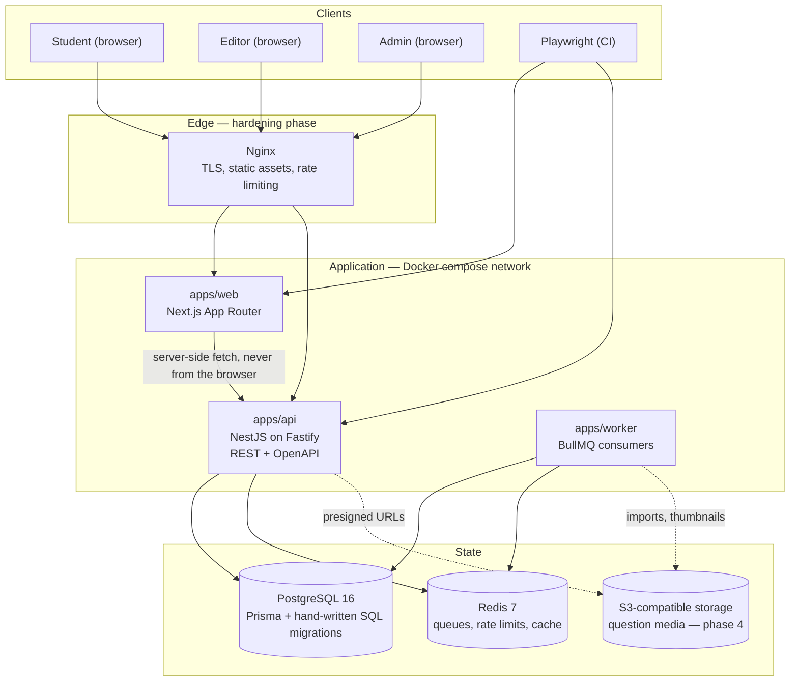
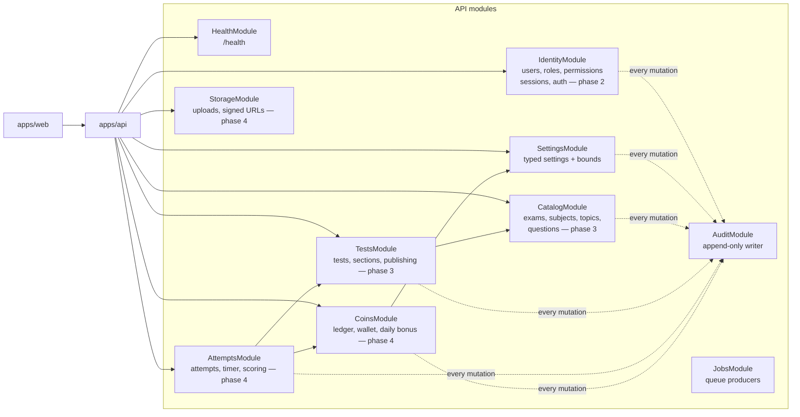
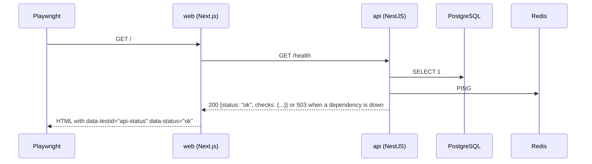
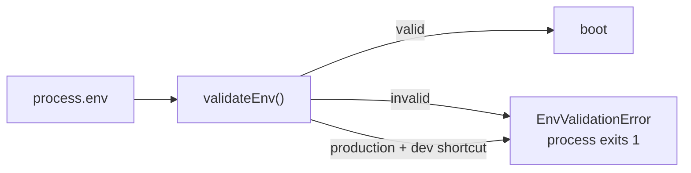

# Architecture

Phase 0 shipped a walking skeleton: every moving part exists, is wired to the next one, and is
proven by CI. Phase 1 adds the identity foundation — users, roles, permissions, per-user
permission overrides, settings and an append-only audit log — and fixes the Release 1 design
that the later phases build inside this shape.

## Release 1 system architecture



Two rules hold this together:

1. **The backend is the only authority** for timers, scoring, answer keys, coins, roles and
   enrollment. The browser renders what the API returns and never decides any of those.
2. **The browser does not hold a base URL to the API.** Server components and route handlers in
   `apps/web` call the API over the internal network, so CORS is not a security boundary and
   session material can stay on the server.

## Module boundaries

Each module owns its tables, its endpoints and its tests. No module reads another's tables
directly; it calls the owning module's service.



| Module | Owns | Explicitly may not |
| --- | --- | --- |
| Health | `/health`, dependency probes | touch identity data |
| Identity | `users`, `roles`, `permissions`, `user_permissions`, `sessions` | compute scores, move coins, edit settings |
| Settings | `settings` (typed, bounds-checked) | be written without an audit entry |
| Audit | `audit_logs` (append-only) | update or delete a row — the database refuses |
| Catalog | `exams`, `subjects`, `topics`, `questions`, `question_options` | publish a test |
| Tests | `tests`, `test_sections`, `test_questions` | expose answer keys before submission |
| Attempts | `test_attempts`, `attempt_answers` | trust a client-supplied clock or score |
| Coins | `coin_ledger`, `coin_wallets`, `daily_login_rewards` | create coins outside the ledger |
| Storage | media metadata, presigned URLs | accept a browser-supplied MIME or size without validation |
| Jobs | BullMQ producers in the API; consumers live in `apps/worker` | be the only path for a user-visible action |

Cross-cutting rules:

- Every privileged mutation writes an audit row in the same transaction as the change.
- Deny by default: a route without an explicit permission requirement is a review failure.
- Object-level checks are mandatory: holding a permission never implies access to every row.

## Repository layout

```
apps/api         NestJS (Fastify) REST API, Prisma, migrations, unit + database tests
apps/web         Next.js App Router UI for students, editors and admins
apps/worker      BullMQ consumers
packages/shared  environment validation and cross-cutting types
e2e              Playwright user flows against the running stack
scripts          CI helpers (failure summary, production compose validation, audit report)
docs             architecture, deployment, data model, permissions, decisions, working rules
```

## Request paths



`/health` answers 200 only when both dependencies respond; otherwise 503 with the same body, so
the web page can show which dependency is down rather than a generic error.

## Configuration and secrets

Environment validation lives in `packages/shared` and is used by both the API and the worker, so
no entry point can forget it.



Production refuses: Turnstile test keys, `fake`/`console` SMS providers, `ALLOW_DEV_LOGIN`,
auth secrets shorter than 32 characters or equal to a known default, and missing secrets.
`docker-compose.prod.yml` additionally requires every secret by name. The admin seed applies the
same discipline: no default password anywhere, and production refuses to run it without the
explicit seed variables plus an explicit confirmation flag.

## Data

Migrations are hand-written SQL applied by `prisma migrate deploy`; Prisma Client is only the
typed access layer. Constraints, partial unique indexes, normalising triggers and append-only
triggers live in SQL because the database is the last line of defence and the only place they
cannot be bypassed by a service bug.

`docs/data-model.md` holds the Release 1 ER diagram. Phase 1 implements `users`, `roles`,
`permissions`, `user_permissions`, `settings` and `audit_logs`; every other table in that diagram
is design only and arrives with the phase that needs it.
