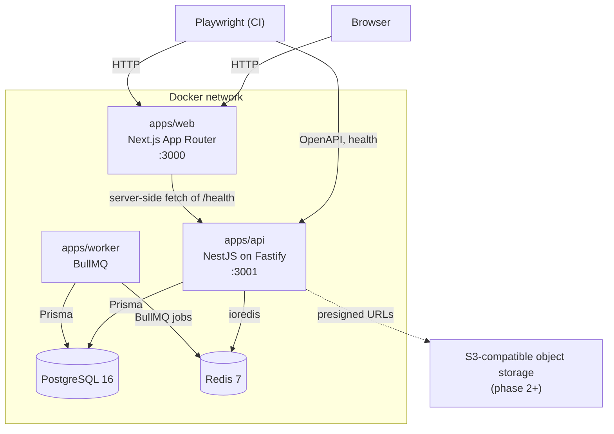
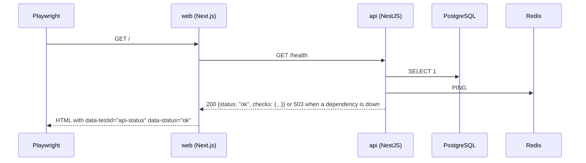
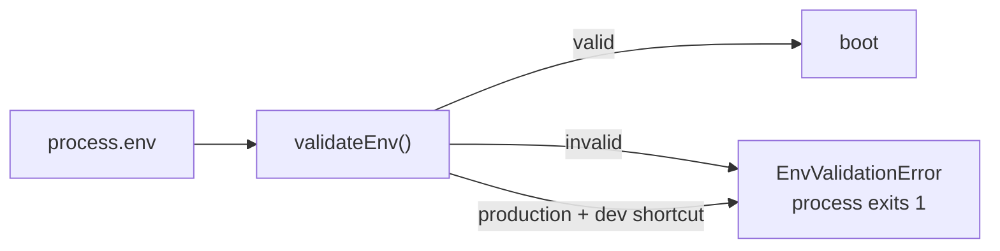

# Architecture

Phase 0 is a walking skeleton: every moving part exists, is wired to the next one, and is
proven by CI. Feature phases add tables, endpoints and screens inside this shape.

## Runtime topology



The browser never talks to the API directly in phase 0; the home page is a server component
that reads `API_INTERNAL_URL`. That keeps the API base URL out of the client bundle and
makes the "backend is the only authority" rule easy to enforce as screens are added.

## Repository layout

```
apps/api        NestJS (Fastify) REST API, Prisma, migrations, unit + database tests
apps/web        Next.js App Router UI for students, editors and admins
apps/worker     BullMQ consumers
packages/shared environment validation and cross-cutting types
e2e             Playwright user flows against the running stack
scripts         CI helpers (failure summary, production compose validation)
docs            architecture, decisions, working rules
```

## Request paths in phase 0



`/health` answers 200 only when both dependencies respond; otherwise 503 with the same body,
so the web page can show which dependency is down rather than a generic error.

## Configuration and secrets

Environment validation lives in `packages/shared` and is used by both the API and the worker,
so no entry point can forget it.



Production refuses: Turnstile test keys, `fake`/`console` SMS providers, `ALLOW_DEV_LOGIN`,
auth secrets shorter than 32 characters or equal to a known default, and missing secrets.
`docker-compose.prod.yml` additionally requires every secret by name, so rendering the file
without one fails before a container starts.

## Data

Phase 0 ships one hand-written migration (`app_metadata`) whose only purpose is to prove that
migrations are applied by the pipeline and that CHECK constraints are enforced by PostgreSQL
rather than by application code. Each later phase adds its own tables in its own migration.
