# Data model — Release 1

Design only, except the six tables marked **phase 1**, which are implemented in
`apps/api/prisma/migrations/20250201000000_identity_foundation`. Every other table below arrives
in the phase that needs it, with its own migration and its own constraint tests. Writing the
whole schema up front is explicitly against the working rules; writing the design down first is
not.

## Entity relationship diagram

```mermaid
erDiagram
  ROLES ||--o{ USERS : "assigned to"
  ROLES ||--o{ ROLE_PERMISSIONS : grants
  PERMISSIONS ||--o{ ROLE_PERMISSIONS : "granted by"
  USERS ||--o{ USER_PERMISSIONS : "extra grant"
  PERMISSIONS ||--o{ USER_PERMISSIONS : "granted by"
  USERS ||--o{ SESSIONS : has
  USERS ||--o{ EMAIL_TOKENS : "confirms with"
  USERS ||--o{ AUDIT_LOGS : "acted"
  USERS ||--|| COIN_WALLETS : holds
  USERS ||--o{ COIN_LEDGER : "ledger entries"
  USERS ||--o{ DAILY_LOGIN_REWARDS : claims
  USERS ||--o{ TEST_ATTEMPTS : takes
  USERS ||--o{ MEDIA_ASSETS : uploads

  EXAMS ||--o{ SUBJECTS : contains
  EXAMS ||--o{ QUESTIONS : scopes
  EXAMS ||--o{ TESTS : offers
  SUBJECTS ||--o{ TOPICS : contains
  SUBJECTS ||--o{ TEST_SECTIONS : "section subject"
  TOPICS ||--o{ QUESTIONS : groups
  QUESTIONS ||--o{ QUESTION_OPTIONS : has
  QUESTIONS ||--o{ TEST_QUESTIONS : "placed as"

  TESTS ||--o{ TEST_SECTIONS : "split into"
  TESTS ||--o{ TEST_QUESTIONS : "contains"
  TEST_SECTIONS ||--o{ TEST_QUESTIONS : "ordered in"
  TESTS ||--o{ TEST_ATTEMPTS : "attempted as"

  TEST_ATTEMPTS ||--o{ ATTEMPT_ANSWERS : records
  QUESTIONS ||--o{ ATTEMPT_ANSWERS : "answered as"
  COIN_LEDGER ||--o| TEST_ATTEMPTS : "charged by"

  USERS {
    uuid id PK
    text email UK "normalised lower(trim())"
    text mobile UK "digits, country code stripped"
    text password_hash
    text full_name
    uuid role_id FK
    text status "ACTIVE | SUSPENDED | DISABLED"
    timestamptz email_verified_at
    timestamptz mobile_verified_at
    timestamptz last_login_at
    timestamptz created_at
    timestamptz updated_at
  }

  ROLES {
    uuid id PK
    text code UK "ADMIN | EDITOR | USER"
    text name
    text description
    boolean is_system
    timestamptz created_at
    timestamptz updated_at
  }

  PERMISSIONS {
    uuid id PK
    text code UK "resource.action"
    text description
    timestamptz created_at
  }

  ROLE_PERMISSIONS {
    uuid role_id FK
    uuid permission_id FK
  }

  USER_PERMISSIONS {
    uuid id PK
    uuid user_id FK
    uuid permission_id FK
    uuid granted_by FK
    timestamptz granted_at
  }

  SETTINGS {
    text key PK
    text value_type "string | integer | boolean"
    text value_text
    integer value_int
    boolean value_bool
    integer min_int
    integer max_int
    text description
    uuid updated_by FK
    timestamptz updated_at
  }

  AUDIT_LOGS {
    uuid id PK
    timestamptz occurred_at
    uuid actor_user_id FK
    text actor_role
    text action
    text entity_type
    uuid entity_id
    jsonb metadata
    inet ip
  }

  SESSIONS {
    uuid id PK
    uuid user_id FK
    uuid family_id
    text refresh_token_hash UK
    text access_token_hash UK
    timestamptz access_expires_at
    inet ip
    text user_agent
    text device_label
    timestamptz issued_at
    timestamptz expires_at
    timestamptz rotated_at
    timestamptz revoked_at
    text revoke_reason
  }

  EMAIL_TOKENS {
    uuid id PK
    uuid user_id FK
    text purpose "VERIFY_EMAIL | RESET_PASSWORD"
    text token_hash UK
    timestamptz expires_at
    timestamptz used_at
    inet request_ip
  }

  DOMAIN_EVENTS {
    uuid id PK
    text name "user.registered | ..."
    jsonb payload
    timestamptz occurred_at
    timestamptz published_at
    integer attempts
  }

  EXAMS {
    uuid id PK
    text code UK
    text name
    text description
    boolean is_active
  }

  SUBJECTS {
    uuid id PK
    uuid exam_id FK
    text code
    text name
  }

  TOPICS {
    uuid id PK
    uuid subject_id FK
    text name
  }

  QUESTIONS {
    uuid id PK
    uuid exam_id FK
    uuid subject_id FK
    uuid topic_id FK
    text type "SINGLE_CHOICE | MULTI_CHOICE | NUMERIC"
    text stem_rich
    text explanation_rich
    text difficulty
    boolean is_active
    uuid created_by FK
  }

  QUESTION_OPTIONS {
    uuid id PK
    uuid question_id FK
    text label
    text body_rich
    boolean is_correct
    integer sort_order
  }

  TESTS {
    uuid id PK
    uuid exam_id FK
    text title
    text kind "FULL_LENGTH | SECTIONAL"
    integer duration_seconds
    integer coin_cost "default 100, editable per test"
    numeric total_marks
    numeric negative_marks
    text status "DRAFT | PUBLISHED | ARCHIVED"
    timestamptz published_at
    uuid created_by FK
  }

  TEST_SECTIONS {
    uuid id PK
    uuid test_id FK
    uuid subject_id FK
    text title
    integer sort_order
  }

  TEST_QUESTIONS {
    uuid id PK
    uuid test_id FK
    uuid section_id FK
    uuid question_id FK
    integer sort_order
    numeric marks
    numeric negative_marks
  }

  TEST_ATTEMPTS {
    uuid id PK
    uuid test_id FK
    uuid user_id FK
    text status "IN_PROGRESS | SUBMITTED | EXPIRED | ABANDONED"
    timestamptz started_at
    timestamptz expires_at "server-authored"
    timestamptz submitted_at
    numeric score
    integer correct_count
    integer wrong_count
    integer unattempted_count
    uuid coin_ledger_id FK
  }

  ATTEMPT_ANSWERS {
    uuid id PK
    uuid attempt_id FK
    uuid question_id FK
    jsonb selected_option_ids
    numeric numeric_answer
    boolean is_correct
    numeric awarded_marks
    timestamptz answered_at
  }

  COIN_WALLETS {
    uuid user_id PK
    integer balance "CHECK balance >= 0"
    timestamptz updated_at
  }

  COIN_LEDGER {
    uuid id PK
    uuid user_id FK
    integer amount "non-zero, signed"
    text reason "SIGNUP_BONUS | DAILY_LOGIN | TEST_ATTEMPT | ADMIN_ADJUSTMENT"
    text reference_type
    uuid reference_id
    text idempotency_key UK
    integer balance_after
    uuid created_by FK
    timestamptz created_at
  }

  DAILY_LOGIN_REWARDS {
    uuid id PK
    uuid user_id FK
    date business_date "Asia/Kolkata"
    uuid ledger_id FK
    timestamptz awarded_at
  }

  MEDIA_ASSETS {
    uuid id PK
    text bucket
    text object_key UK
    text mime_type
    integer size_bytes
    uuid uploaded_by FK
    timestamptz created_at
  }
```

## What each phase implements

| Phase | Tables | Why now |
| --- | --- | --- |
| 1 | `users`, `roles`, `permissions`, `user_permissions`, `settings`, `audit_logs` | Identity foundation: who exists, who may do what, and a tamper-evident record |
| 2 | `sessions`, `email_tokens`, `role_permissions`, `domain_events` | Authentication with opaque tokens, single-use email tokens, role→permission resolution and the transactional outbox that grants the signup bonus |
| 3 | `exams`, `subjects`, `topics`, `questions`, `question_options`, `tests`, `test_sections`, `test_questions` | Content authoring and publishing |
| 4 | `test_attempts`, `attempt_answers`, `coin_wallets`, `coin_ledger`, `daily_login_rewards` | Taking tests, server-authoritative timer and scoring, and the coin ledger that pays for attempts |
| 5 | `media_assets` | Object storage for question media, behind Nginx |

## Invariants the database enforces, not the application

- **Email** is normalised to `lower(btrim(email))` by a trigger before insert and update, and is
  unique. Case-insensitive uniqueness is therefore a property of the data, not of a query.
- **Mobile** is normalised to digits with a leading `91` country code or `0` trunk prefix
  stripped, then constrained to exactly ten digits, and is unique when present.
- **Settings** carry their type in the row: a value that does not match its declared type, an
  integer outside its `min_int`/`max_int` bounds, or a blank/over-long string is rejected by a
  single CHECK constraint.
- **Audit log** rows can be inserted and read, never updated, deleted or truncated: a trigger
  raises for every session, and the application's database role has those privileges revoked.
- **Sessions** store only the SHA-256 hash of a token pair, never the token itself, with one row
  per pair and a CHECK that keeps `revoked_at` and `revoke_reason` in step. Presenting a refresh
  token that was already rotated revokes the whole family as `REUSE_DETECTED`.
- **Email tokens** are hashed, purpose-scoped, single use and expire 30 minutes after issue. A new
  verification link marks the previous one used, so exactly one link works at a time.
- **Domain events** are written in the same transaction as the row they describe, so an account
  cannot exist without its `user.registered` event. `published_at` and `attempts` are the worker's
  outbox bookkeeping.
- **Coins** (phase 4) will be append-only with `amount <> 0`, `balance_after >= 0`, a unique
  idempotency key, and writes taken under a `SELECT … FOR UPDATE` on the wallet row.

## Conventions

- Every primary key is a UUID (`gen_random_uuid()`), so ids are not enumerable and can be
  generated before insert.
- Every timestamp is `timestamptz` stored in UTC; business dates (the daily login bonus) are
  computed in Asia/Kolkata and stored as a `date`.
- Soft deletion is a `status` or `deleted_at` concern of a later phase; audit rows and ledger
  rows are never deleted.
