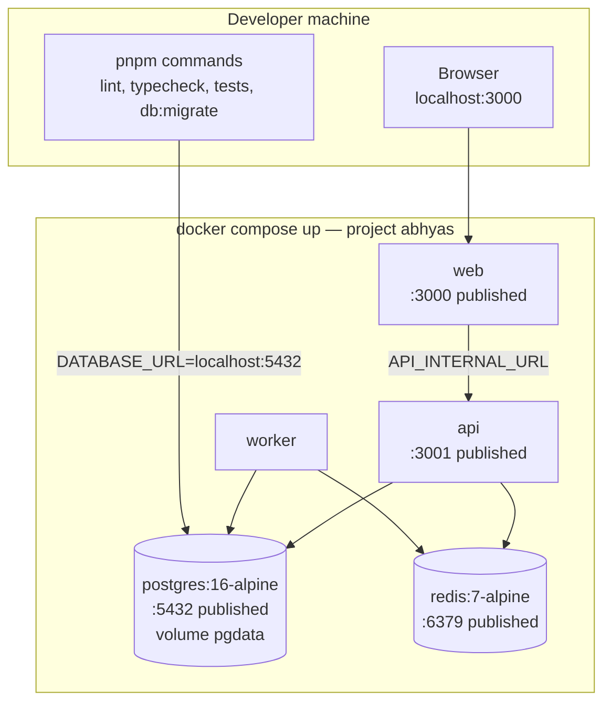

# Deployment

Two compose files, one topology. Development is for people; production is for the platform, and
it refuses to start without its secrets.

## Development

- Every service has a healthcheck; `docker compose up --wait` blocks until the stack is actually
  serving, which is exactly what the `compose-smoke` and `e2e` CI jobs rely on.
- Database ports are published in development only, so host-side `pnpm db:migrate` and
  `pnpm test:db` work.
- `ALLOW_DEV_LOGIN`, a Turnstile test key and the `fake` SMS provider are set here — and are
  refused by the boot gate when `NODE_ENV=production`.

## Production

Production invariants, asserted by `scripts/validate-compose-prod.mjs` in the `docker` CI job:

- Postgres, Redis and the API publish **no** host ports; only the web tier is reachable.
- `NODE_ENV=production` in every service; no `ALLOW_DEV_LOGIN`, no `fake`/`console` SMS.
- Every secret is required by name (`${VAR:?message}`), so rendering the file without one fails
  before any container starts. A default secret is therefore impossible to deploy.
- Named volumes only; no bind mounts of host paths.
- Migrations run as a one-shot service that the API waits on, so a replica never serves against
  an unmigrated schema.

## Planned edge and storage (phase 5)

Nginx will terminate TLS, serve the Next.js static assets and rate-limit the auth endpoints.
Object storage will hold question media: the API issues presigned upload/download URLs and never
proxies bytes. Both are drawn here because they change the deployment shape, and neither exists
yet — they are listed as known gaps in `PROGRESS.md`.

## CI mapping

| Concern | Job |
| --- | --- |
| Images build from the repository | `docker` |
| Production topology has no shortcuts | `docker` (`validate-compose-prod.mjs`) |
| The stack comes up and serves health and docs | `compose-smoke` |
| A user can open the home page against the running stack | `e2e` |
